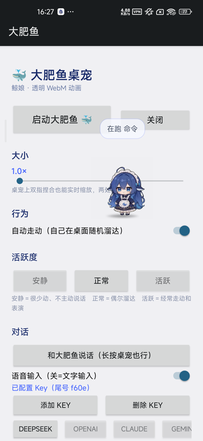
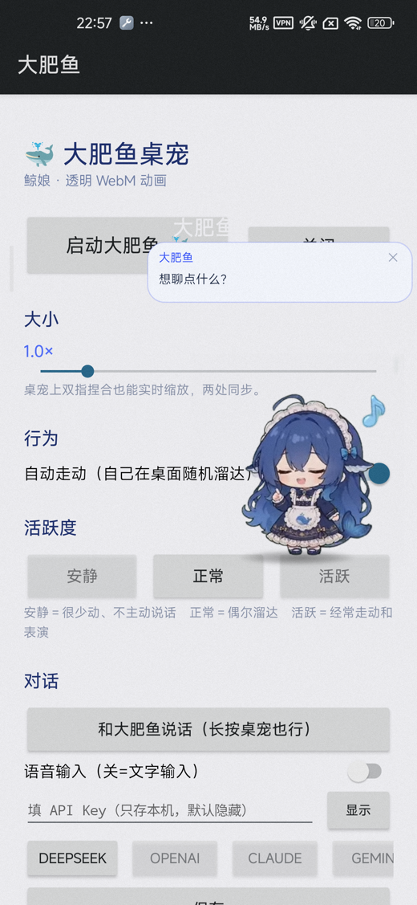

# 大肥鱼桌宠 · dafeiyu-pet

一只会跑会说话、会看 DSH 状态的 Android 桌面宠物。

名字来自 DeepSeek 鲸鱼娘的社区二创「大肥鱼」；非官方粉丝作品，与 DeepSeek 官方无关。



## 这是什么

- 悬浮在桌面上的透明动画鲸鱼娘，106 段动作素材，双缓冲交叉淡化
- 会自己走动、待机呼吸、随机表演；被点、被拖、被甩都有回应
- 点一下弹气泡聊天，可以打字，也可以长按说话（接语音转写服务）
- 可选接 DeepSeek / OpenAI / Claude / Gemini / Kimi / 智谱 / 通义；Key 只存本机
- 可选本地「状态桥」：让桌宠显示 DSH（DeepSeek Harness）会话正在干什么

原生层是 Java 悬浮窗（`SYSTEM_ALERT_WINDOW`），渲染和动画在 `assets/pet.html` 里用 WebView 播透明 WebM。

## 安装

1. 到 [Releases](../../releases) 下载最新的 `dafeiyu-pet-v*.apk`
2. 安装后打开「大肥鱼」，授予「显示在其他应用上层」和通知权限
3. 点「启动大肥鱼」；建议把电池优化设为「不限制」，否则息屏后容易被系统回收

最低 Android 8.0（API 26），targetSdk 34。

## 用法

| 操作 | 效果 |
|---|---|
| 拖动 | 移动（沿路径走，方向对应左右） |
| 双指捏合 | 实时改大小 |
| 点击 | 弹出两行互动条：上排 吃白饭 / 爱心 / 睡觉，下排 设置 / 随机表情 |
| 长按 | 打开聊天气泡（语音/文字在气泡里切换） |
| 双击 | 查 DeepSeek 余额（仅 DeepSeek + 填了 Key） |
| 快速甩 | 撞边反弹 |

App 内的设置页也还在：大小滑块、自动走动、活跃度三档（安静 / 正常 / 活跃，带每分钟频率拉杆）、气泡开关、语音开关、音效开关、DSH 状态联动、Key 管理。

### 设置气泡 / 表情类别 / 聊天

- **设置**（齿轮）：桌宠旁边弹出窄气泡（44vw），只放条目 + 当前值，气泡本身可滚动。
- **条目变抽屉**：大小 / 自动走动 / 活跃度 / 语音输入 / 气泡说话 / 音效 / DSH 联动，点条目在气泡旁边弹出控制抽屉（32vw，可滚动），气泡不消失。
- **表情类别**：点类别（干饭 / 节日 / 玩耍 / 才艺 / 搞怪 / 动作 / 舞蹈 / 工作 / 碎碎念 / 休息），同样在气泡旁边弹出该类抽屉（32vw，可滚动），点名字直接演。
- **气泡位置**：优先放桌宠上方/下方，放不下再放侧边；始终避开桌宠、夹在屏幕内，桌宠走动时每 300ms 重新对齐。
- **移动**：现有素材里没有真正的走路循环（`原地左转奔跑` 实为转身→趴下→睡→醒，`螃蟹走路` 为转身→爬→躺，已归到「动作」表情）。移动统一用 `原地漂浮踏步`：向左/上/下原版，向右水平镜像（否则像倒走）；速度 `120 × scale` px/s，时长 = 距离 / 速度。
  顺序固定为「先镜像/回正 → 新片段首帧 → 再位移」：镜像瞬间完成，位移等首帧画上去后再启动（双 rAF），不会窗口先动、动画后到。
- **随机表情**：从 83 段表演素材里抽；任意连续 10 次里不出现重复。走路用的漂浮踏步、待机呼吸、点击回应、余额动画不进池；原「左转奔跑 / 螃蟹走路」现在归在「动作」类里。
- **聊天气泡**：点「和大肥鱼说话」或长按桌宠打开。输入框和回复共用同一张气泡——发送后输入框收起、回复浮现；点回复又切回输入。麦克风/键盘按钮切换语音和文字，右上角 ✕ 关闭。有 API Key 走线上，没 Key 自动落到本地人设台词。



## 对话与语音

- **不填 Key**：走本地闲聊 `LocalChat`，有人设台词和时间感知，但不会真的推理。
- **填 Key**：设置页选服务商、贴 Key 即可；也支持「自定义」OpenAI 兼容地址。Key 存 `SharedPreferences`，界面不回显，也不会打进安装包。
- **语音**（二选一）：
  - 系统语音识别：系统自带，部分机型/离线时不可用；
  - 自建 faster-whisper：默认 `http://127.0.0.1:8077`，兼容 `POST /v1/audio/transcriptions`；也可以填云端 OpenAI 兼容地址。
- **DSH 状态联动**（默认关闭）：需要本机跑一个桥接进程，向 `http://127.0.0.1:8078/state` 返回 `{"state": "..."}`。没装 DSH 就保持关闭，不影响其他功能。

帮助页里在 App 内也有（设置 → 帮助）。

## 从源码构建

依赖：

- Android SDK：`build-tools;34.0.0` + `platforms;android-34`
- JDK 8+（`javac -source 1.8`）、`zip`、`bash`
- 在 arm64 上跑官方 x86_64 构建工具需要 `qemu-x86_64`（`build.sh` 已写死这个前缀）

```bash
# 仓库不含签名文件，先自己生成一个 debug keystore
keytool -genkeypair -keystore debug.keystore -alias androiddebugkey \
  -storepass android -keypass android -keyalg RSA -keysize 2048 \
  -validity 10000 -dname "CN=Android Debug,O=Android,C=US"

./build.sh          # 产物 dafeiyu-pet.apk
```

`build.sh` 里的 SDK 路径是 `/opt/android-sdk`，按自己的环境改脚本顶部。

## 目录

```
AndroidManifest.xml        权限、悬浮窗 Service、调试广播
build.sh                   aapt2 → javac → d8 → zipalign → apksigner
java/com/dafeiyu/pet/
  MainActivity.java        设置页、Key 管理、帮助
  PetService.java          悬浮窗、拖动/缩放/甩飞、气泡定位、保活
  ChatActivity.java        气泡对话输入
  ChatClient.java          多协议聊天（OpenAI / Anthropic / Gemini）
  LocalChat.java           无 Key 时的本地台词
  AsrClient.java           语音转写（本地/云端）
  SysAsr.java              系统语音识别
  LinkPoller.java          轮询状态桥
  BalanceClient.java       DeepSeek 余额
  Providers.java           服务商预设
  DbgReceiver.java         调试入口（DUMP 权限）
assets/
  pet.html                 舞台、双缓冲 WebM、气泡、互动特效
  webm/                    106 段透明动画
  sounds/                  音效
  webm_custom/             自定义片段
tools/
  mk_pet_html.py           由动作清单生成 pet.html
  actions.json             动作池配置（待机/点击/随机/走动）
  alpha_bbox.py 等         素材处理脚本
res/                       图标与三视图
docs/images/               README 截图
```

## 已知限制

- 悬浮窗是矩形，气泡要越出角色包围盒就得自己算坐标；部分机型 WebView 不支持 VP9 alpha，会看到黑底（设置页「自检」可查）。
- 高版本 MIUI / HyperOS 对后台悬浮窗管得严，需要手动允许「显示在其他应用上层」并关掉电池优化。
- 语音走系统识别时依赖系统服务；走本地 whisper 时需要有进程常驻。
- 动画素材体量较大（约 53 MB），仓库不小是正常的。

## 致谢

- 动作播放与双缓冲思路参考 [elyoncatnecoe/whale-pet](https://github.com/elyoncatnecoe/whale-pet)（MIT）。
- 角色形象来自 DeepSeek 鲸鱼 logo 的社区二创，版权归原作者；本仓库仅作学习交流。
- 第三方组件许可见 [THIRD-PARTY-NOTICES.md](THIRD-PARTY-NOTICES.md)。

## License

代码以 MIT 协议开源，见 [LICENSE](LICENSE)。素材（角色形象、动画、音效）不随代码授权，请勿商用。

版本历史见 [CHANGELOG.md](CHANGELOG.md)。
